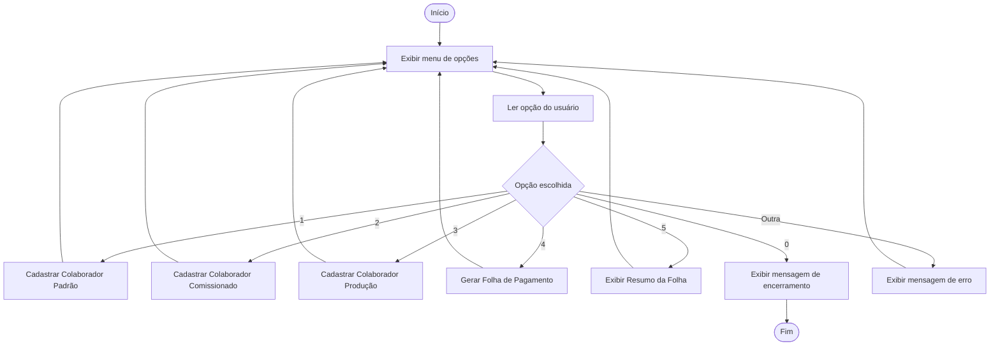
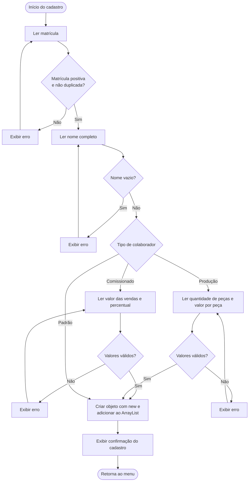
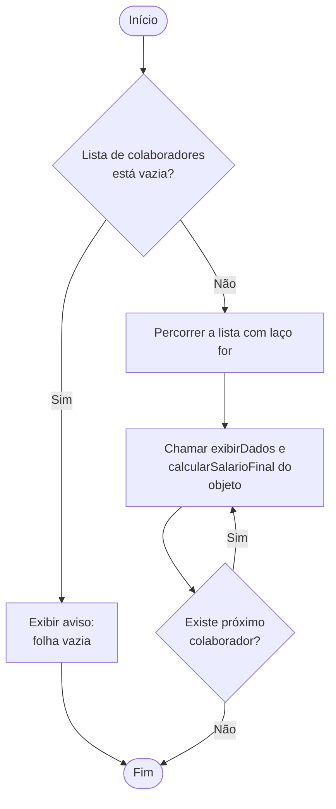
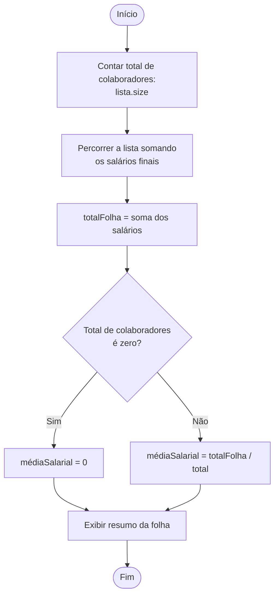

# Fluxogramas — Sistema de Folha de Pagamento

Este documento apresenta os fluxogramas do funcionamento do sistema, escritos
na sintaxe [Mermaid](https://mermaid.js.org/). Para visualizá-los, basta abrir
o arquivo no GitHub ou em qualquer visualizador de Markdown compatível com
Mermaid (por exemplo, a extensão *Markdown Preview* do VS Code).

---

## 1. Menu principal

O menu é exibido em laço (`do-while`) e só encerra quando o usuário escolhe
a opção `0`. Opções inválidas mostram mensagem de erro e o menu aparece
novamente.

---

## 2. Cadastro de colaboradores

Os três cadastros seguem o mesmo fluxo: leem a matrícula (verificando se ela
é válida e não está duplicada), leem o nome (que não pode ser vazio) e, nos
tipos comissionado e de produção, leem também os valores adicionais. No final,
o objeto é criado com `new` e adicionado ao `ArrayList<Colaborador>`.

---

## 3. Geração da folha de pagamento

A lista é percorrida com um laço de repetição. Para cada objeto, o programa
chama `exibirDados()` e `calcularSalarioFinal()`, que são executados de forma
diferente para cada tipo de colaborador graças ao **polimorfismo** (sem
precisar usar `instanceof`).

---

## 4. Cálculo do resumo salarial

O resumo reutiliza métodos auxiliares (`calcularTotalFolha` e
`calcularMediaSalarial`) para não repetir código. A média é calculada apenas
se houver colaboradores, evitando divisão por zero.

